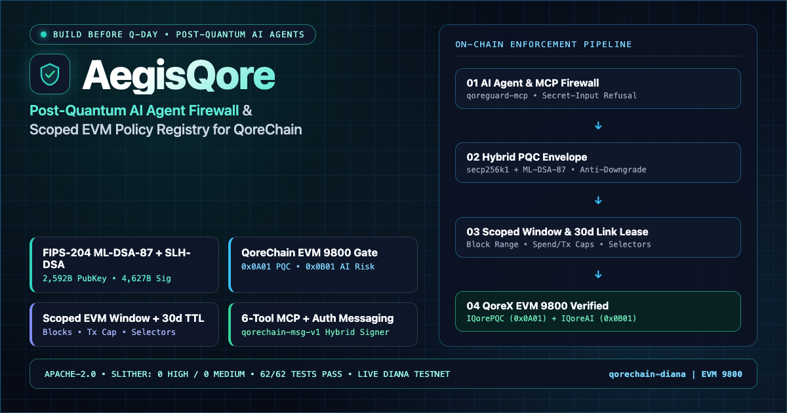
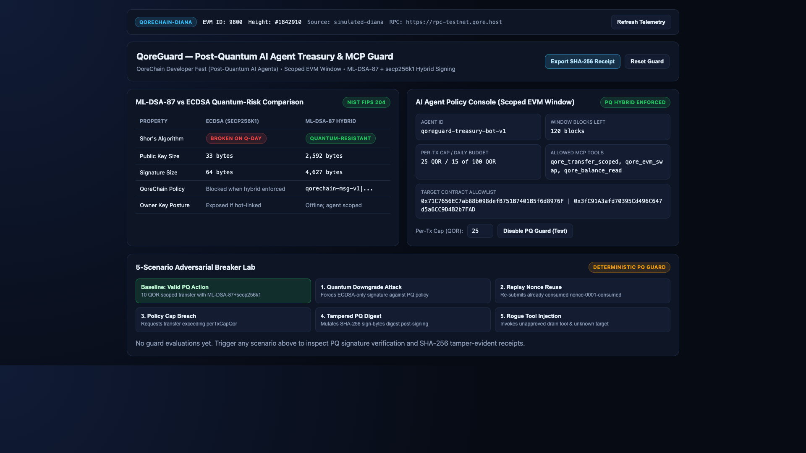
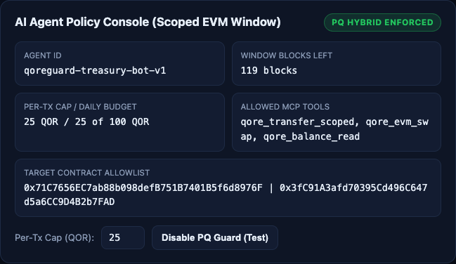
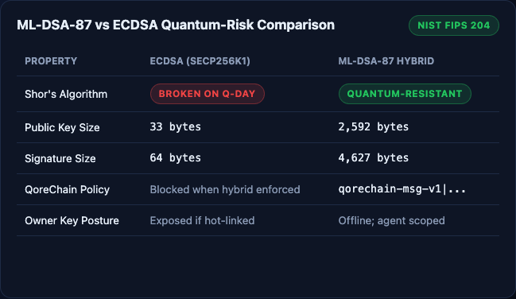

# QoreGuard — Post-Quantum AI Agent Policy Engine, MCP Server & Interactive Console for QoreChain / QoreX



**QoreGuard** is a unified, Apache-2.0 post-quantum security stack for autonomous AI agents operating on **QoreChain / QoreX** (`qorechain-diana`, EVM Chain ID `9800`). It pairs real NIST post-quantum cryptography (`@qorechain/pqc` FIPS-204 **ML-DSA-87 / ML-DSA-65**, FIPS-205 **SLH-DSA**, FIPS-202 **SHAKE-256**), on-chain **Scoped EVM Windows** & **30-day owner-to-agent link leases**, official **`qorechain-msg-v1|<chainId>|<data>`** hybrid `secp256k1 + ML-DSA-87` authenticated messaging, a 6-tool **Model Context Protocol** server (`qoreguard-mcp`), live QoreX Testnet precompile verification, and an interactive web console (`web/`).

- **Live GitHub Pages Demo**: [https://alphonshhhomenicmtu.github.io/qoreguard-qorechain/](https://alphonshhhomenicmtu.github.io/qoreguard-qorechain/)
- **1080p Demo Video (YouTube, 108s)**: [https://www.youtube.com/watch?v=La_8Dh7TA04](https://www.youtube.com/watch?v=La_8Dh7TA04)
- **1080p Demo Video Mirror (Google Drive)**: [https://drive.google.com/file/d/1luPFpSazP9o20nE1wC738ppocV_4eZUo/view?usp=sharing](https://drive.google.com/file/d/1luPFpSazP9o20nE1wC738ppocV_4eZUo/view?usp=sharing)
- **Public Repository**: [https://github.com/alphonshhhomenicmtu/qoreguard-qorechain](https://github.com/alphonshhhomenicmtu/qoreguard-qorechain)
- **AI Transparency**: See [AI_USAGE.md](AI_USAGE.md) (Best AI-Native Build submission) and [SUBMISSION_READY.md](SUBMISSION_READY.md).

---

## Live QoreX Testnet Verification Proof

Running `npm run probe:testnet` executes a real read-only probe against **QoreChain Testnet (`qorechain-diana`, EVM Chain ID `9800`)**, generating a fresh FIPS-204 **ML-DSA-87** keypair (`2,592`-byte public key, `4,627`-byte signature) via `@qorechain/pqc` and verifying it **both locally and on-chain** via QoreChain's live EVM precompile `IQorePQC.pqcVerify` (`0x0000000000000000000000000000000000000A01`):

- **Network**: `qorechain-diana` (`EVM Chain ID: 9800`, live verified block `10,801,339`, consensus height `10,801,340`)
- **`IQorePQC.pqcVerify` (`0x...0A01`)**: `available: true`, **`verified: true`** (`on-chain ML-DSA-87 verify=true`)
- **`IQorePQC.pqcKeyStatus` (`0x...0A02`)**: `available: true`
- **`IQoreConsensus.rlConsensusParams` (`0x...0C01`)**: `available: true` (`blockTime=5000, baseGasPrice=100, validators=4, epoch=1`)
- **On-Chain Smart Contract (`contracts/QoreGuardPolicyRegistry.sol`)**:
  - Integrates directly with QoreChain native precompiles `0x...0A01` (`pqcVerify`), `0x...0A02` (`pqcKeyStatus`), `0x...0B01` (`aiRiskScore`), and `0x...0B02` (`aiAnomalyCheck`).
  - Enforces **30-day maximum owner-to-agent link TTL** (`MAX_LINK_TTL = 30 days`, `renewAgentLink()`, `relinkAgentKey()`), **Scoped EVM Windows** (`openScopedEvmWindow(agent, startBlock, endBlock, maxTxCount, maxTotalValue, windowTargets)`), official **`qorechain-msg-v1|<chainId>|<data>`** hybrid `secp256k1 + ML-DSA-87` message verification (`verifyAuthenticatedMessage` & `verifyAgentAuthenticatedMessage`), per-tx & O(1) two-epoch sliding-window daily caps, target/selector allowlists (default-blocking `approve` and `setApprovalForAll`), strict monotonic nonces, emergency owner revocation, and tamper-evident `PolicyApproved` / `PolicyRejected` / `AgentRevoked` events.
  - **Live QoreX EVM 9800 Dry-Run Gas Estimate (`npm run deploy:registry -- --dry-run`)**: **`3,480,337` gas** (`0.3915379125 QOR` @ `112.5 gwei`, block `10,802,524`, `15,896`-byte Solc `0.8.28` `paris` creation bytecode, SHA-256 `7c304cb1...87c2cdce`).
  - **Static Security Audit (`Slither 0.11.6`, 102 detectors)**: **`0 High / 0 Medium / 0 Optimization`** findings.
- **Automated Test Suites**: **62 / 62 PASS** (`18/18` Foundry incl. 256-run fuzz + `36/36` core Vitest incl. InMemory MCP round-trip + `8/8` web Vitest)

---

## Visual Walkthrough

| Live Telemetry & Hybrid PQC Overview | Post-Quantum Policy Console & Adversarial Breaker Lab |
|---|---|
|  |  |
|  |  |

---

## Monorepo Architecture

```text
qoreguard/
├── contracts/
│   ├── QoreGuardPolicyRegistry.sol        # On-chain QoreX EVM 9800 PQ Agent Policy Registry (0x...0A01/0A02/0B01/0B02)
│   └── test/QoreGuardPolicyRegistry.t.sol # 18 Foundry tests (vm.etch precompiles, 30d TTL, Scoped EVM Window, qorechain-msg-v1, fuzz)
├── foundry.toml                           # Solc 0.8.28 (paris, optimizer=200) + QoreChain RPC endpoints
├── src/
│   ├── contracts/registry-artifact.ts     # Compiled QoreGuardPolicyRegistry ABI + verified creation bytecode
│   ├── networks.ts              # Verified QoreChain testnet/mainnet/localnet presets, precompile ABIs (0x...0901-0C01), 30d MAX_AGENT_LINK_TTL_SEC
│   ├── types.ts                 # Strict TypeScript contracts for policies, Scoped EVM Windows, 30d link leases, qorechain-msg-v1, and audit bundles
│   ├── crypto.ts                # FIPS-204 ML-DSA-87/65/44 (@qorechain/pqc) + FIPS-205 SLH-DSA + secp256k1/ed25519 + hybridSignBytes('v2') + qorechain-msg-v1
│   ├── policy-engine.ts         # Stateful spending caps, Scoped EVM Windows, 30d link renewal, selector firewall, 6-vector breaker, SHAKE-256 + ML-DSA-87 ledger
│   ├── guard.ts                 # Secret-input refusal guard (blocks private keys / BIP-39 mnemonics in MCP tool calls)
│   ├── testnet-client.ts        # Live QoreX read-only RPC/precompile probe + env-var-driven turnkey guarded tx runner (honest simulation fallback)
│   ├── registry-deployer.ts     # Turnkey QoreGuardPolicyRegistry gas estimator & EVM deployer
│   ├── mcp/
│   │   ├── server.ts            # 6-tool qoreguard-mcp server aligned with @qorechain/mcp conventions
│   │   └── bin.ts               # Stdio CLI entry point for MCP clients
│   └── scripts/
│       ├── deploy-registry.ts   # `npm run deploy:registry -- --dry-run` live EVM 9800 gas estimator & turnkey deployer
│       ├── testnet-probe.ts     # `npm run probe:testnet` live QoreX read-only probe
│       └── turnkey-tx.ts        # `npm run tx:turnkey` env-var-driven guarded tx / dry-run demo
├── test/                        # 36 Vitest tests (crypto + qorechain-msg-v1, policy-engine + 30d TTL + Scoped Window, MCP, testnet, deployer)
├── web/                         # Interactive React 19 + Vite 6 + TypeScript console deployed to GitHub Pages (8 Vitest tests)
├── docs/
│   ├── cover-image.png          # 1200x630 Featured Cover Image for QoreChain submission
│   └── screenshots/             # Captured high-resolution UI screenshots
├── AI_USAGE.md                  # AI-assisted engineering disclosure (Best AI-Native Build)
└── SUBMISSION_READY.md          # Complete QoreChain Developer Fest submission checklist & evidence
```

---

## MCP Tools (`qoreguard-mcp`)

Aligned with `@qorechain/mcp` (`structuredContent` + JSON content + secret-input refusal):

| Tool | Purpose |
|---|---|
| `verify_pq_tx` | Verifies hybrid classical + ML-DSA-87/SLH-DSA envelopes against active policy and commits nonce/spend/audit state on `ALLOW`. |
| `quote_policy_decision` | Side-effect-free pre-flight quote returning `ALLOW`/`DENY`, remaining caps, velocity snapshot, and rejection codes. |
| `simulate_quantum_downgrade_attack` | Runs 6 deterministic adversarial vectors in an isolated shadow engine (strip PQC, v2→v1 sign-bytes downgrade, ML-DSA-87→44 downgrade, commitment amount tamper, signature bit-flip, nonce replay). |
| `export_audit_bundle` | Exports the SHAKE-256 hash-chained & ML-DSA-87 attested audit bundle with independent `verifyAuditBundle` confirmation. |
| `probe_qorex_network` | Live read-only probe of QoreChain Testnet/Mainnet RPC, consensus status, and PQC/AI/Consensus EVM precompiles. |
| `register_agent_policy` | Registers a scoped PQ agent policy and returns its deterministic SHAKE-256 `policyHashHex`. |

---

## Quickstart & Reproducibility

### Core SDK, Policy Engine & MCP Server (`36 / 36` Vitest PASS)

```bash
npm install
npm run typecheck
npm run build
npm test
```

### On-Chain Smart Contract (`18 / 18` Foundry PASS, Slither `0 High / 0 Medium`)

```bash
forge build
forge test -vv
# Live QoreX EVM 9800 deployment gas estimation (no private key required):
npm run deploy:registry -- --dry-run
# Turnkey live broadcast (env var QOREX_PRIVATE_KEY only; never commit keys):
# QOREX_PRIVATE_KEY=0x... npm run deploy:registry -- --broadcast
```

### Live QoreX Testnet Probe & Turnkey Guarded Tx Runner

```bash
# Live read-only probe against qorechain-diana (EVM 9800) + on-chain IQorePQC.pqcVerify (0x...0A01)
npm run probe:testnet

# Offline deterministic simulation fallback
QOREGUARD_OFFLINE=true npm run probe:testnet

# Turnkey guarded tx dry-run (zero hardcoded keys; set QOREGUARD_PRIVATE_KEY + QOREGUARD_DRY_RUN=false for live broadcast)
npm run tx:turnkey

# Start MCP stdio server
node dist/mcp/bin.js --network testnet
```

### Interactive Web Console (`8 / 8` Vitest PASS)

```bash
cd web
npm install
npm run typecheck
npm test
npm run build
```

---

## Credits & Open-Source Libraries

QoreGuard builds directly on the official QoreChain developer ecosystem and audited open-source cryptography libraries:
- [`@qorechain/pqc`](https://github.com/qorechain/qorechain-pqc), [`qorechain-sdk`](https://github.com/qorechain/qorechain-sdk), and [`qorechain-mcp`](https://github.com/qorechain/qorechain-mcp) (QoreChain Association)
- `@noble/post-quantum`, `@noble/curves`, `@noble/hashes` (Paul Miller)
- `@modelcontextprotocol/sdk`, `viem`, `zod`, `React`, `Vite`, `Vitest`, `tsup`

## License

Apache-2.0 (see [LICENSE](LICENSE)).
